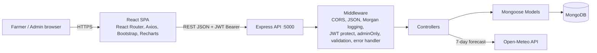
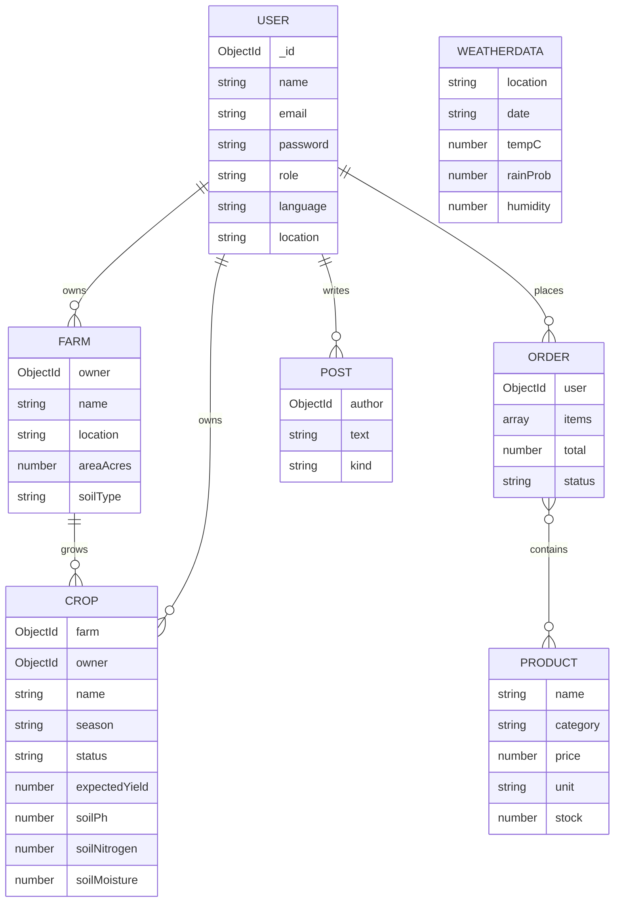
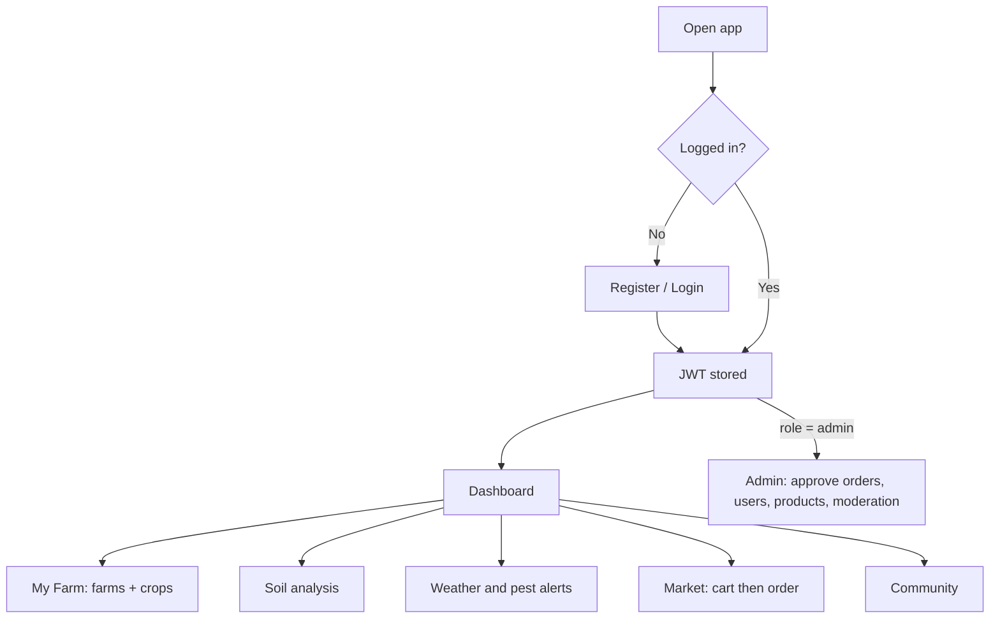

# 🌾 KhetiMitra – AgriTech Smart Farming Platform

Full-stack MERN application that empowers farmers with weather forecasts, soil analysis, pest alerts, a resource marketplace, expert consultation and a community forum, with role-based access (Farmer / Admin) and English/Hindi support.

**Stack:** MongoDB · Express.js · React 18 · Node.js 18+ · JWT · bcrypt · Bootstrap 5 · Axios · Recharts
**Live UI preview (static demo):** https://claude.ai/artifact/YFNTfJmc8y6TKQ1fQwpdZg  (also in `docs/ui-preview.html`)

---------------------------------------------------------------------

# 1. PROJECT ARCHITECTURE

## 1.1 Technical Architecture


## 1.2 ER Diagram


## 1.3 Features
| Module | What it does |
|---|---|
| Auth | Register/login, bcrypt-hashed passwords, JWT (7 days) |
| Farm profile | CRUD for farms (area, soil type, location) |
| Crop monitoring | CRUD for crops (season, status, expected yield, soil readings) |
| Soil health | Score + advice from pH, nitrogen, moisture |
| Weather & pests | Live 7-day forecast (Open-Meteo, cached in MongoDB) + rule-based pest/weather alerts |
| Marketplace | Browse resources, cart, place orders, track status |
| Experts & forum | Expert list, community questions/tips |
| Admin dashboard | Stats, order approval, user management, product management, forum moderation |
| i18n / UX | English + Hindi, responsive Bootstrap UI, charts, lazy-loaded pages |

## 1.4 Roles and Responsibilities
| Role | Permissions |
|---|---|
| **Farmer** (default on signup) | Manage own farms/crops, soil analysis, weather & alerts, shop and place orders, post in forum |
| **Admin** (created via seed only) | Everything above on all data + approve/reject orders, manage products, delete users, moderate posts, view platform stats |

Admin routes are protected twice: client `Guard admin` and server `adminOnly` middleware.

## 1.5 User Flow


## 1.6 MVC Pattern
| Layer | Location | Example |
|---|---|---|
| **Model** | `server/models/*.js` | `Crop.js` (Mongoose schema) |
| **View** | `client/src/pages`, `components` | `Dashboard.js` (React) |
| **Controller** | `server/controllers/*.js` | `orders.js` (business logic) |
| Routes | `server/routes/index.js` | maps URL + middleware to controller |

---------------------------------------------------------------------

# 2. PROJECT SETUP AND CONFIGURATION

## 2.1 Project folder
```
agritech/
├── README.md
├── docs/               (ui-preview.html, screenshots/)
├── server/             (Express + MongoDB backend)
└── client/             (React frontend)
```

## 2.2 Client folder (frontend)
```bash
cd client
npm install        # react, react-router-dom, axios, bootstrap, recharts
```
## 2.3 Server folder (backend)
```bash
cd server
npm install        # express, mongoose, cors, dotenv, bcryptjs, jsonwebtoken, express-validator, morgan
cp .env.example .env
```
`.env` values: `PORT`, `MONGO_URI`, `JWT_SECRET`, `CLIENT_URL`.

For local development, if `MONGO_URI` uses the default local URL and MongoDB is
not installed or running, the server automatically starts an embedded MongoDB
instance. Data in this fallback database is temporary and is lost when the
server stops. Use MongoDB or MongoDB Atlas for persistent data.

---------------------------------------------------------------------

# 3. BACKEND DEVELOPMENT

## 3.1 Structure
```
server/
├── server.js            entry: connects DB, starts listener
├── app.js               Express app: middleware, routes, error handling
├── seed.js              demo data (admin, farmer, crops, products)
├── config/db.js         Mongo connection
├── models/              User Farm Crop Order Product WeatherData Post
├── controllers/         auth crud soil weather orders misc
├── middleware/          auth (protect, adminOnly) validate error
└── routes/index.js      all REST endpoints
```

## 3.2 Development and explanation
* **Auth** – `controllers/auth.js` hashes passwords (model pre-save hook), signs a JWT `{id, role}`; public signup always creates a *farmer*.
* **Security** – `protect` verifies the token and loads the user; `adminOnly` checks role. Inputs validated with express-validator.
* **Generic CRUD** – `controllers/crud.js` builds list/create/update/delete for Farms and Crops; farmers are scoped to `owner = req.user.id`; field whitelisting prevents mass-assignment.
* **Soil** – `controllers/soil.js` scores pH, N and moisture and returns advice.
* **Weather & pests** – `controllers/weather.js` fetches Open-Meteo, caches to MongoDB (falls back to cache offline) and derives alerts (rust risk, aphids, heat stress, heavy rain).
* **Orders** – prices are re-read from DB on checkout (client cannot tamper with totals); admin sets status.
* **Logging & errors** – Morgan request logs + central `errorHandler` (validation, duplicate key, bad id).

### REST API
| Method | Endpoint | Access |
|---|---|---|
| POST | `/api/auth/register`, `/api/auth/login` | public |
| GET | `/api/auth/me` | user |
| GET/POST/PUT/DELETE | `/api/farms`, `/api/crops` (+`/:id`) | user (own data) |
| POST | `/api/crops/analyse-soil` | user |
| GET | `/api/weather`, `/api/weather/alerts` | user |
| GET | `/api/products` · POST/PUT/DELETE | user · admin |
| GET/POST | `/api/orders` · PUT `/api/orders/:id/status` | user · admin |
| GET/POST · DELETE | `/api/posts` · `/api/posts/:id` | user · admin |
| GET | `/api/dashboard` | user |
| GET/DELETE | `/api/admin/stats`, `/api/admin/users` | admin |

---------------------------------------------------------------------

# 4. DATABASE DEVELOPMENT

1. **Configure MongoDB** – install MongoDB Community locally (`mongodb://127.0.0.1:27017/agritech`) or create a free MongoDB Atlas cluster and paste its URI in `MONGO_URI`.
2. **Connection** – `server/config/db.js` uses `mongoose.connect(process.env.MONGO_URI)`.
3. **Schemas and models** – `server/models/` (see ER diagram). Collections: Users, Farms, Crops, Orders, WeatherData (+ Products, Posts). Relations use `ObjectId` refs with `populate`.
4. **Seed** – `npm run seed` creates demo accounts and data.

---------------------------------------------------------------------

# 5. FRONT-END DEVELOPMENT

## 5.1 Structure
```
client/src/
├── index.js, App.js     providers + routes (lazy-loaded pages, route guards)
├── api.js               Axios instance + JWT interceptor
├── i18n.js              English/Hindi dictionary + hook
├── context/AuthContext.js
├── components/          Navbar.js, Crud.js (reusable table + form)
└── pages/               Login Dashboard Farms Soil Weather Market Community Admin
```
## 5.2 Development and explanation
* **Auth context** stores the user, token in `localStorage`; the Axios interceptor adds `Authorization: Bearer`, and auto-logs-out on 401.
* **Route guards** protect pages and the admin route.
* **`Crud.js`** is one reusable component for farms, crops and admin products (add, edit, delete, validation errors).
* **Charts** with Recharts (yield bar chart, forecast line chart).
* **Performance** – `React.lazy` + `Suspense` code splitting.
* **Responsive & multilingual** – Bootstrap grid, language switcher (EN/हिन्दी).

---------------------------------------------------------------------

# 6. PROJECT EXECUTION

## 6.1 Steps for execution
```bash
# Prerequisites: Node.js 18+, MongoDB running (or Atlas URI)
git clone <your-repo-url> && cd agritech

# Terminal 1 – backend
cd server && npm install && cp .env.example .env
npm run seed          # demo data
npm run dev           # http://localhost:5000/api/health

# Terminal 2 – frontend
cd client && npm install && npm start     # http://localhost:3000
```
**Demo logins** – Admin: `admin@agritech.in` / `Admin@123` · Farmer: `ramesh@farm.in` / `Farmer@123`

**Testing with Postman:** `POST /api/auth/login` → copy `token` → add header `Authorization: Bearer <token>` → call `/api/farms`, `/api/weather`, etc. Wrong/missing token returns 401; farmer calling `/api/admin/*` returns 403.


